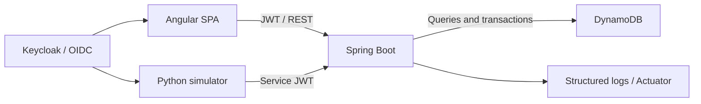

# FleetOps

An independently designed educational device inventory and security compliance platform. Spring Boot and Angular simulate Apple fleet workflows using persistent DynamoDB records, OIDC identities, versioned policies, and transactional audit evidence. **This is not Apple MDM and cannot control real devices.**

## Current build

A working vertical slice, under active development. Inventory registration/detail/update/retirement, tenant-scoped reads, cursor pagination, six compliance rule types, immutable policy versions, authenticated telemetry, replay/stale-write protection and audit history are implemented. Angular provides inventory, detail, policy and audit screens. The Python simulator generates synthetic fleets.

Not complete: organization/member administration, platform administration, indexed search/filtering, full-fleet dashboards and trends, automatic policy-change re-evaluation, persistent authorization-denial audit, full Terraform application hosting, and comprehensive accessibility review. Policy UI edits one rule/target per policy; compound policies are supported by the API. No cloud deployment has occurred.

## Stack

Java 21; Spring Boot 3.5.16; AWS Java SDK v2 2.59.0; Spring Security resource server; Springdoc 2.8.17; Angular 21; Angular Material 21; TypeScript 5.9; Node 22 LTS; Python 3.11+; DynamoDB; Keycloak 26.8.2; Maven; JUnit/Mockito/Testcontainers; Vitest; Playwright.

Frontend exact resolved versions are recorded in `frontend/package-lock.json`. Use `npm ci`. No global CLI installation is required.



## Local setup

Prerequisites: Docker Engine/Desktop with Compose. Local credentials below are intentionally public demo credentials, valid only for the loopback-bound development realm.

```sh
git clone https://github.com/naveenseedani21/fleetops.git
cd fleetops
docker compose up --build
```

Open http://localhost:4200 after Keycloak and the backend start. Sign in with `admin` / `local-admin-only` or `viewer` / `local-viewer-only`. Admin belongs to `demo` and `lab`; viewer only to `demo`. The simulator service account has only `INGESTOR` in `demo`.

The Docker startup path is supplied but must be validated on a Docker-capable machine; see [validation evidence](docs/VALIDATION.md) for what was actually executed. DynamoDB and Keycloak use named persistent volumes. Do not expose this Compose stack publicly.

For native development, run DynamoDB Local and Keycloak using the same realm in `infrastructure/keycloak/`, initialize the table with `scripts/init-db.sh` (AWS CLI required), then:

```sh
# Terminal 1: Java 21 and Maven
export AWS_ACCESS_KEY_ID=local AWS_SECRET_ACCESS_KEY=local AWS_REGION=us-east-1
export DYNAMODB_ENDPOINT=http://localhost:8000
mvn -f backend/pom.xml spring-boot:run
# Terminal 2: Node 22
cd frontend
npm ci
npm start
```

The Keycloak public issuer must be `http://localhost:8180/realms/fleetops`. Import the supplied realm with `start-dev --import-realm --http-port=8180 --hostname=http://localhost:8180`. Serve the UI on `localhost`, matching the registered redirect URI. `/actuator/health` includes a database-table check.

## Synthetic demo

```sh
export FLEETOPS_CLIENT_SECRET=local-simulator-secret-not-for-production
python3 simulator/fleetops_sim.py register --count 100 --seed 42
python3 simulator/fleetops_sim.py check-in --count 100
python3 simulator/fleetops_sim.py check-in --count 10 --scenario noncompliant
```

Create policies through the UI before checking in to observe compliance changes. New devices are `UNKNOWN`; evaluation without applicable policies is `NOT_APPLICABLE`. An inactivity scenario backdates reports and is accepted only for a device without a newer check-in; use a fresh fleet/state file. Reports cannot rewind existing device state.

## Validation

```sh
# Docker required for Testcontainers unless TEST_DYNAMODB_ENDPOINT is supplied
AWS_ACCESS_KEY_ID=local AWS_SECRET_ACCESS_KEY=local mvn -f backend/pom.xml spotless:check verify
cd frontend
npm run format:check
npm run lint
npm test
npm run build
npm run e2e # running local backend, Keycloak and frontend required
cd ..
python3 -m unittest discover -s simulator -v
docker compose config --quiet
```

## API and security

API prefix: `/api/v1/organizations/{organization}/`. JWT claims assign tenant membership and role. Every service authorizes before persistence access. Platform roles grant no implicit tenant access. Signed JWTs validate issuer, audience, expiry and signature. Browser login uses authorization code + PKCE; simulator uses client credentials without administrator access.

OpenAPI JSON is available at `/v3/api-docs` with an access token. See [API guide](docs/api/API.md), [threat model](docs/security/THREAT_MODEL.md), [data model](docs/architecture/DATA_MODEL.md), and [operations](docs/OPERATIONS.md).

## Hosting

Hosting is planned only after the owner approves the build. The target is ECS Fargate for the API and S3/CloudFront for Angular, with DynamoDB and a production OIDC provider. The initial Terraform foundation is not a complete hosted application. No deployment workflow is enabled and no resources have been provisioned. See [deployment readiness](docs/DEPLOYMENT.md).
