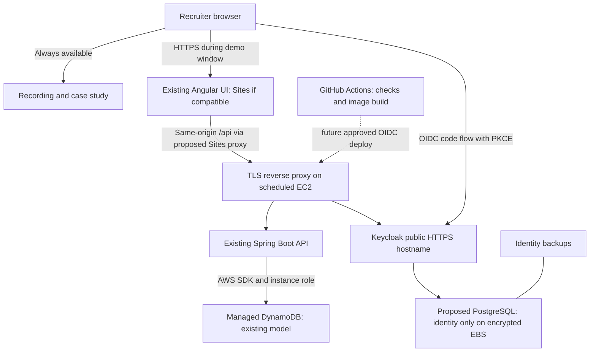

# FleetOps hosting proposal

> **Superseded:** the owner now requires strict $0 spending. Paid and scheduled AWS options below are historical research, not recommendations or authorization. Use [the current $0 plan](ZERO_COST_PORTFOLIO_PLAN.md).

Research date: 2026-11-13. Status: **planning only; no architecture or spending approved for execution**. No cloud accounts, Sites, deployments, DNS records, secrets, access controls or paid settings were created or changed. Prices are USD before tax; estimates are not quotes or spending caps.

## Recommendation

For this Jamf application, retain the verified Docker application and make a short recorded walkthrough the primary reviewer experience. If live cloud evidence is wanted, add an **owner-started AWS EC2 demo**, normally stopped, with a target of 40 running hours/month and a reviewed maximum of 100. Budget approximately **$11–$15/month including a domain allowance**, without promotional credits. Keep the recording available when the backend is stopped. This demonstrates AWS, Docker, CI/CD and security without buying an always-on enterprise topology.

Use Sites for the Angular frontend only if its public-access and compatibility gates below pass. An alternative is to serve the same Angular build from the EC2 reverse proxy during appointments; that avoids an extra integration and preserves same-origin `/api/` requests. A separate always-available case-study/recording page can use Sites. Creating such a page or changing the application is not authorized by this research approval.

Do not choose permanent ECS Fargate for this budget. Do not promise a reliable zero-cost deployment of two Java services plus persistent identity. If an always-on live app is mandatory, first benchmark the $12 Lightsail configuration locally under equivalent limits. Its 2 GB total RAM is a risk; the 4 GB alternative starts at $24 before extras and exceeds the preferred ceiling. No automatic upgrade is proposed.

## Scope and assumptions

- Preserve Angular, Java 21/Spring Boot, Keycloak, DynamoDB, report contracts, tenant boundaries and A1–A3. No Cognito, Supabase, SQLite application database, JavaScript backend rewrite or mock backend.
- Small synthetic fleet (around 100 devices), a few simultaneous reviewers, at most 10 GB monthly public transfer, 1 GB application data, 1 GB logs, and deliberately bounded simulator runs. Not a high-availability production service.
- AWS estimates use US East (N. Virginia), 730 hours/month where always-on. No savings-plan commitment, purchased support or promotional credits assumed. Account eligibility and exact checkout prices remain unverified.
- Cloud data is a new synthetic dataset. Existing native/Docker records and volumes remain untouched. Do not upload local realm credentials, traces, database files or administrator secrets.
- **Identity database addition requires approval:** the local Compose file runs Keycloak `start-dev` with its development database. A public deployment should use production-mode Keycloak with a supported persistent database, proposed PostgreSQL solely for Keycloak. This does not replace FleetOps's DynamoDB, but it is an additional technology/configuration decision and has not been implemented. If declined, keep the existing stack local. [Keycloak production guidance](https://www.keycloak.org/server/configuration-production), [database guidance](https://www.keycloak.org/server/db).
- Keycloak recommends a 2 GB container limit for smaller production deployments. A tuned demonstration may use less, but that is an experiment, not a verified requirement. Reserve room for Spring, PostgreSQL, the proxy and OS. [Keycloak container memory guidance](https://www.keycloak.org/server/containers).

## Comparison

Totals include the components detailed below. Sites rows assume eligible existing hosting entitlement with $0 incremental hosting; subscription cost is excluded. If a new subscription is needed, add it before approval. Domain allowance is $1–$2/month amortized, paid annually; an existing suitable domain avoids that purchase. Taxes and abnormal traffic can exceed estimates.

| Option | Monthly planning estimate | Availability and persistence | HTTPS / authentication / public review | Assessment |
|---|---:|---|---|---|
| Existing local Docker + recording/screenshots | $0 incremental cloud hosting | Local volumes persist; owner machine needed for live use | Current loopback stack is not public HTTPS; recording can be shared separately | Best immediate portfolio value; no cloud-runtime claim |
| Sites + scheduled EC2, 40–100 hours | **$11–$15** | EBS identity data and DynamoDB persist while EC2 is stopped; live login unavailable then | HTTPS and Keycloak feasible during scheduled windows; Sites access must be verified | **Preferred optional live deployment** |
| AWS Lightsail 2 GB + DynamoDB; Angular on VM or Sites | **$14–$18** | Always-on, persistent disk; single-host failure risk | HTTPS proxy + production Keycloak feasible if memory test passes | Near budget, but cannot recommend capacity yet |
| AWS Lightsail 4 GB + DynamoDB | **$26–$30** | More memory; persistent disk; still one host | Same as above | Above preferred ceiling |
| AWS EC2 4 GB continuously, no ALB | **$40–$43** | Always-on EBS + DynamoDB | HTTPS proxy and instance-role AWS access | Simpler than ECS, still over budget |
| Sites + Railway containers + AWS DynamoDB | **$22–$34** typical model | Persistent PostgreSQL volume; two Java services billed while awake | Managed HTTPS; public endpoints; Keycloak remains responsible for tenant identity | Low operational effort, variable cost often exceeds $25 |
| Render paid services + PostgreSQL + DynamoDB | **$41–$63** | Persistent paid identity DB; always-on paid services | Managed HTTPS and Docker; public app possible | Predictable but too expensive |
| Render free services + free PostgreSQL | $0 initially, **not a durable solution** | Ephemeral service files; free PostgreSQL expires after 30 days | HTTPS available, but sleep and identity persistence fail long-term needs | Reject for the recruiter-facing app |
| AWS ECS Fargate + ALB + RDS + DynamoDB + static frontend | **$93–$118** | Persistent managed databases; single tasks in this estimate, not HA | HTTPS ALB and proper identity feasible | Good future architecture exercise; wrong portfolio budget |

## Cost derivation

### Scheduled EC2: preferred live option

One Linux `t3.medium` (2 vCPU, 4 GiB) runs Docker containers for the existing API, Keycloak, proposed identity PostgreSQL and TLS reverse proxy. Angular can live there or on Sites. Build images in CI, not on the small host. Use an EC2 instance role for DynamoDB, with no stored AWS access keys.

| Component | 40 hours/month | 100 hours/month | Basis |
|---|---:|---:|---|
| EC2 compute, including identity service | $1.67 | $4.18 | $0.0418/hour shown in current AWS T3 table |
| Retained public IPv4 | $3.65 | $3.65 | $0.005 × 730; budget even while stopped |
| 30 GB gp3 persistent disk | $2.40 | $2.40 | $0.08/GB-month, baseline IOPS/throughput |
| DynamoDB requests/storage/PITR | $0.50 | $0.50 | Small-fleet allowance; see workload formula below |
| Identity backup storage | $0.50 | $0.50 | Planning allowance for small retained backups |
| Logs, health checks and scheduling | $0.50 | $0.50 | Bounded-volume allowance, not unlimited monitoring |
| DNS | $0.50 | $0.50 | One Route 53 zone; queries negligible at assumed traffic |
| Registry, static assets, transfer reserve | $0.50 | $0.50 | Tiny retained images/assets; validate account allowances |
| Infrastructure subtotal | **$10.22** | **$12.73** | No ALB, NAT gateway, RDS or paid WAF |
| Optional domain amortization | $1–$2 | $1–$2 | Registrar/TLD quote needed; annual cash payment |
| Estimated total | **$11.22–$12.22** | **$13.73–$14.73** | Tax extra; retain contingency below $25 |

Rates: [EC2 T3](https://aws.amazon.com/ec2/instance-types/t3/), [IPv4](https://aws.amazon.com/vpc/pricing/), [gp3](https://aws.amazon.com/ebs/general-purpose/), [DNS](https://aws.amazon.com/route53/pricing/). Small storage/monitoring reserves are engineering allowances, not provider quotes. At 730 compute hours the same model is approximately $40–$43 with domain; scheduling is the saving, not a free server.

Leave the stable address allocated so Keycloak's hostname and redirect configuration remain consistent. Releasing it saves money but requires DNS updates and introduces startup complexity. Stop/start preserves EBS; termination and volume deletion are separate actions. Use explicit CPU-credit policy: Standard avoids unlimited-credit surcharges but may throttle. Load-test startup and login under that policy before approval to publish.

### DynamoDB shared allowance

Retain the SDK/persistence implementation and use managed DynamoDB through configuration. At illustrative rates of $0.625/million write request units and $0.125/million read request units, 100,000 WRUs + 100,000 RRUs cost $0.075. One GB storage at $0.25/GB adds $0.25 before applicable allowances; reserve the remainder of $0.50 for tiny backup/PITR usage. Real rates/eligibility must be confirmed for the selected region. Transactional writes, item-size rounding and multiple items per report mean **one report is not one WRU**. History currently reads its prefix for pagination, so larger histories also increase usage. A continuous synthetic fleet reporting every minute can invalidate this estimate. [DynamoDB pricing](https://aws.amazon.com/dynamodb/pricing/).

### Always-on and managed alternatives

**Lightsail:** published IPv4 Linux bundles are $12 for 2 GB and $24 for 4 GB, including disk and transfer allowance. Add $0.50 DynamoDB, $0.50–$1 backups, $0–$0.50 monitoring, $1–$2 domain and $0–$1 other usage: approximately $14–$18 or $26–$30. Keycloak/PostgreSQL are included in host compute, not omitted. Existing disk is persistent but is not a backup. A small backup allowance assumes compact database exports, not repeated full 60/80 GB snapshots. Stopping a Lightsail instance **does not stop its charges**. AWS credential delivery also needs review: do not assume Lightsail provides the EC2 application-role workflow. [Lightsail pricing](https://aws.amazon.com/lightsail/pricing/), [billing while stopped](https://docs.aws.amazon.com/en_en/lightsail/latest/userguide/amazon-lightsail-frequently-asked-questions-faq-billing-and-account-management.html).

**Railway hybrid:** assume 0.5 GB average API RAM, 1–2 GB Keycloak RAM and 0.25 GB PostgreSQL RAM: $17.50–$27.50 at $10/GB-month. Add $2 aggregate CPU (0.1 vCPU average × $20), 5 GB volume $0.75, 10 GB egress $0.50, DynamoDB $0.50 and $0.50–$2 backup/monitoring reserve: approximately $22–$34. The Hobby $5 is a minimum usage commitment with included usage, not an extra $5 on top of this total. Provider domains can avoid buying a domain. Memory/CPU averages are unmeasured assumptions; Keycloak startup spikes and idle connections matter. Managed HTTPS does not manage Keycloak upgrades or database recovery for you. Cross-cloud AWS runtime credentials require a separately approved secure mechanism; GitHub OIDC for deployments alone does not solve runtime authentication. [Railway resource pricing](https://docs.railway.com/pricing), [billing explanation](https://docs.railway.com/pricing/understanding-your-bill).

**Render:** $7/512 MB API is a low-end experiment; $25/2 GB is a safer alternative. Budget $25/2 GB for Keycloak, $6 minimum PostgreSQL compute plus storage, $0.50 DynamoDB and $2.50–$6.50 disk/backup/egress reserve: roughly $41–$63. Keycloak license cost is $0; hosting it is not free. Free service files cannot hold persistent identity, and free database expiry makes that route unsuitable. [Render compute prices](https://render.com/articles/set-up-self-hosted-github-actions-runners-on-render), [database/disk prices](https://render.com/pricing), [free-tier restrictions](https://render.com/docs/free).

**ECS:** API 0.5 vCPU/1 GB about $18.02; Keycloak 0.5 vCPU/2 GB about $21.27. ALB base $16.43, low-traffic LCU allowance $0.50–$3, four IPv4 addresses (two tasks, two ALB AZs) $14.60. Add $20–$35 planning allowance for small single-AZ RDS PostgreSQL including storage/backups (exact instance quote still needed), DynamoDB $0.50, and $2–$7 for static delivery, registry, logs and DNS, plus $1–$2 domain. Total about $93–$118. No NAT assumed: tasks have public egress, inbound restricted to ALB, database private. NAT adds material fixed cost. This corrects the older API-only estimate by including identity and its database. [Fargate](https://aws.amazon.com/fargate/pricing/), [ALB](https://aws.amazon.com/elasticloadbalancing/pricing/), [RDS pricing to finalize](https://aws.amazon.com/rds/postgresql/pricing/).

## Proposed architecture

The Sites proxy is a **proposal requiring a compatibility test**, not an existing capability configured for FleetOps. If it is unsuitable, Angular served by the EC2 proxy uses the current same-origin API design directly. There is no reason to rewrite the application to make Sites mandatory.

## Sites integration findings and gates

I used the installed Sites plugin skill (version 1.1.6) for the hosting contract; its supported outputs are static assets or a Cloudflare Worker module. It does not describe a JVM/container hosting target. Sites cannot supply this existing backend/Keycloak stack through that deployment path.

OpenAI currently includes Sites hosting with Plus/Pro; Enterprise hosting charges are currently waived. Building/editing consumes Codex usage. Public publishing availability depends on the account/workspace; new Sites are private. We have not verified this account's public access, limits or contract. Do not count this as a guaranteed forever-free public host. [Official Sites documentation](https://help.openai.com/en/articles/20001339-creating-and-using-chatgpt-sites).

| Area | Current repository | Requirement before hosting |
|---|---|---|
| Build | Angular production build; nginx image | Publish unchanged Angular assets in a supported Sites output directory. nginx configuration does not run on Sites. Preserve `inlineCritical:false`. |
| Deep links | nginx `try_files ... /index.html` | Prove `/devices/:id`, `/policies`, `/audit` return the SPA after refresh. Keep assets, `/config.json` and API errors out of SPA fallback. |
| API routing | Relative `/api/`; nginx proxies to backend | Preferred minimal adapter forwards `/api/*` to one fixed HTTPS API origin, preserving bearer headers, methods, bodies, status, error contract and query strings. Never permit arbitrary proxy targets or log tokens. Sites HTTP server support exists, but asset/proxy packaging must be tested. |
| Direct API alternative | Interceptor only attaches tokens to `/api/` | Would need approved API-base configuration and an exact-origin token allowlist, plus backend CORS/preflight handling. Merely changing a URL is insufficient. |
| CORS | No explicit CORS setup in inspected Spring security chain | Same-origin proxy avoids browser API CORS. Direct cross-origin access needs exact frontend origin, permitted methods and Authorization/Content-Type headers; no wildcard credential policy. Keycloak Web Origins still needs the frontend origin. CORS is not authorization. |
| Identity | issuer localhost8180, `requireHttps:false`; callback `origin + '/'` | Public HTTPS Keycloak issuer, `requireHttps:true`, exact registered root callback and approved logout return URLs; preserve code+PKCE and audience/tenant claims. Do not replace Keycloak identity with Sites headers. |
| CSP / headers | nginx CSP permits only self and local issuer | Reproduce security headers through supported hosting controls; allow real HTTPS issuer and API only as necessary. Verify login/logout at top level, session storage, refresh and error paths. |
| Public audience | No Site registered | Verify an external recruiter can reach the chosen audience without unexpected ChatGPT access gates, then complete Keycloak login. Public Site audience is a separate approval from creating a private preview. |
| Backend security | JWT issuer/JWKS/audience config; SDK default credential chain | Set exact HTTPS issuer/JWKS/audience, remove local DynamoDB endpoint and dummy credentials; instance role restricted to the intended table. Proxy cannot weaken tenant/device checks. |

The supplied Sites identity reference says to confirm external-provider support. Therefore a real Keycloak round trip, deep-link test and header test are mandatory gates after deployment/testing approval. No existing integration was claimed verified. Avoid a localhost/home-computer tunnel as a permanent service: owner laptop availability and an additional exposure boundary would remain.

## Scheduling, free tiers and cost controls

An owner starts EC2 before the appointment, waits for PostgreSQL and Keycloak readiness, then API database-aware readiness, and performs a real login. Stop it after the demo using an approved owner-controlled schedule. Budget several minutes of warm-up; actual timing needs measurement. Do not add an anonymous “start server” endpoint: it could let strangers incur costs. The recorded walkthrough remains the primary unsolicited recruiter link.

Railway serverless sleeping may reduce compute, but outbound traffic/database pools can prevent sleep and the first request can return 502. It is not a dependable budget until measured with this stack. Render free services sleep after 15 idle minutes, take approximately a minute to wake, share 750 free instance-hours per workspace, and cannot attach persistent disks. Two always-awake free services exceed that pool; artificial keep-alive traffic is not a solution. [Railway sleeping](https://docs.railway.com/deployments/serverless), [Render free](https://render.com/docs/free).

Stopping ECS tasks leaves ALB, database, storage and IP costs; stopping Lightsail leaves instance charges. Stopping EC2 retains disk/IP costs already included above. No scheduled deletion of stored data is proposed.

AWS new-account offers are account/date dependent and temporary; do not base the steady-state budget on “12 months free.” Current documentation advertises up to $200 credits with time limits; confirm this account's actual balance/expiry later. [AWS Free Tier FAQ](https://aws.amazon.com/free/free-tier-faqs/).

Budget alerts can arrive after charges accrue; ordinary AWS Budgets alerts are not a hard cutoff. New AWS project spend limits may provide pausing where supported, but require a Paid Plan, have a minimum of at least $20, and have account-specific constraints. They are not assumed enabled or universally available. Paused-project data can be deleted after 90 days of inaction. [Budget delays](https://docs.aws.amazon.com/cost-management/latest/userguide/budgets-managing-costs.html), [project spend-limit rules](https://docs.aws.amazon.com/accounts/latest/reference/create-spend-limit.html).

Propose alerts at $10/$15/$20, a reviewed ceiling below $25 including tax, bounded runtime, no autoscaling, short log retention, image cleanup policies and request throttling. Validate any automatic stop action's data consequences separately. Watch domain renewals, unattached IPs, snapshots, NAT/endpoints, surplus CPU credits, database traffic, backup retention, managed monitoring, CI minutes, registry storage and egress. No promise of an absolute $25 cap without verified provider enforcement.

## Deployment sequence — only after explicit architecture/cost approval

1. Approve scheduled EC2 vs another option, region, runtime-hour budget, domain cash cost, Sites/public audience, and PostgreSQL for Keycloak. Confirm current pricing/eligibility and account controls. Stop if the full quote exceeds the chosen ceiling.
2. Locally benchmark the unchanged services with intended CPU/RAM constraints. Validate a proposed production Keycloak configuration and restore workflow against a new synthetic realm, never converting current local data in place. This work needs a separate implementation approval.
3. Prepare reviewed Terraform/deployment overlays: encrypted EBS, DynamoDB deletion protection/PITR, exact table IAM permissions, instance role, restricted administration, backups and budgets. Audit current Terraform actions against actual SDK calls and transaction paths; do not assume the existing ECS-oriented role can be attached unchanged to EC2.
4. Configure production identity: distinct admin/viewer/machine identities, no committed fixture passwords, exact redirect origins, appropriate token lifetime, isolated administration endpoints, trusted proxy headers. Enable only HTTPS public entry points; databases and management ports stay private.
5. Prepare CI/CD using GitHub OIDC restricted to this repository and an approved environment. Build and scan immutable image digests, retain all five checks, then use a separately approved deploy step. Existing CI does not currently deploy.
6. Show the exact infrastructure plan and updated quote; obtain final deployment approval before applying anything. No apply commands were run during this proposal.
7. After authorized provisioning, seed a new synthetic fleet with administrator credentials and report through the restricted machine identity. Verify A2/A3, report replay after restart, tenant denial, history and API error contracts against the hosted system.
8. If using Sites, package Angular plus the minimal approved routing adapter; verify deep links, HTTPS/CSP, external Keycloak login/logout/refresh and external audience. Keep private until public access is explicitly approved. If it fails, seek approval for the same-origin EC2 frontend fallback rather than replacing auth.
9. Verify persistent identity/application state across stop/start, backup restoration in isolation, actual memory use and billing, automatic shutdown, and rollback to prior image digest. Database rollback is a separate reviewed operation.
10. Publish a genuine 3–5 minute walkthrough and update evidence with actual commands/results. Never label a proposed architecture as deployed or a local DynamoDB run as AWS cloud execution.

## Recruiter presentation

Lead with the Operations UI and one complete device lifecycle: administrator provisioning → restricted machine report → failed compliance → corrected report → unchanged lifecycle. Then show tenant/viewer denials, replay safety, a green CI run and the architecture tradeoffs. Include the existing genuine screenshots and concise setup instructions. A recording is more reliable for an unsolicited application than a sleeping login page; a scheduled live cloud session adds evidence when requested.

This project demonstrates full-stack implementation, automated delivery and security reasoning without needing 24/7 ECS. The current GitHub repository is private, so recruiter source access must be arranged separately with owner approval; recording access and repository access are different decisions. Recording creation/upload, access changes, implementation and deployment are all still pending approval. No recording is claimed created by this research task.
