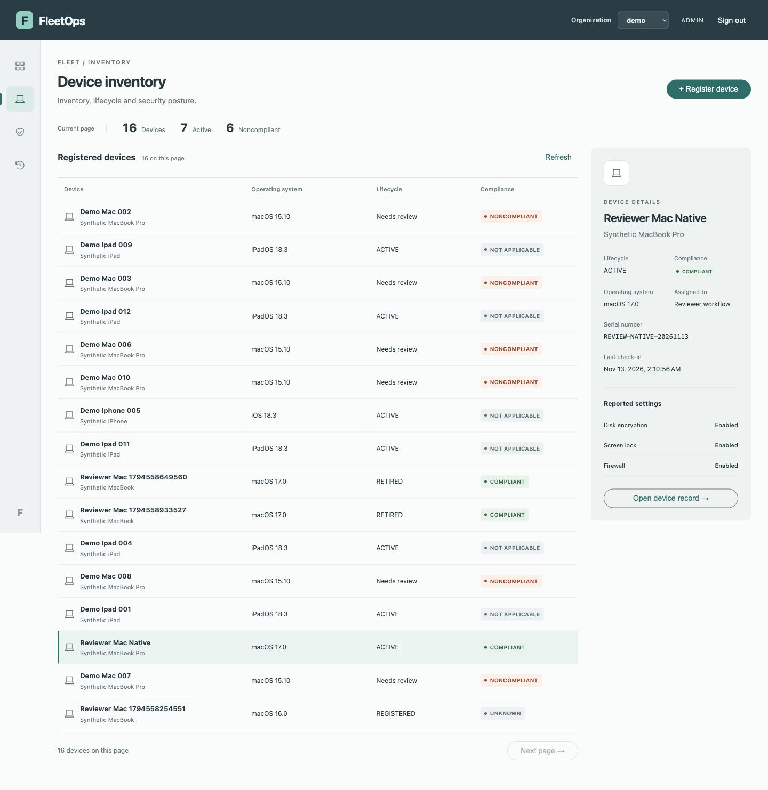
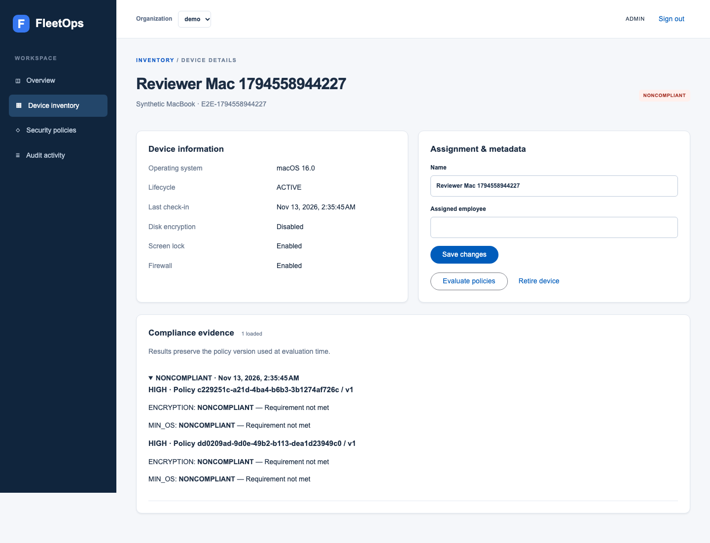
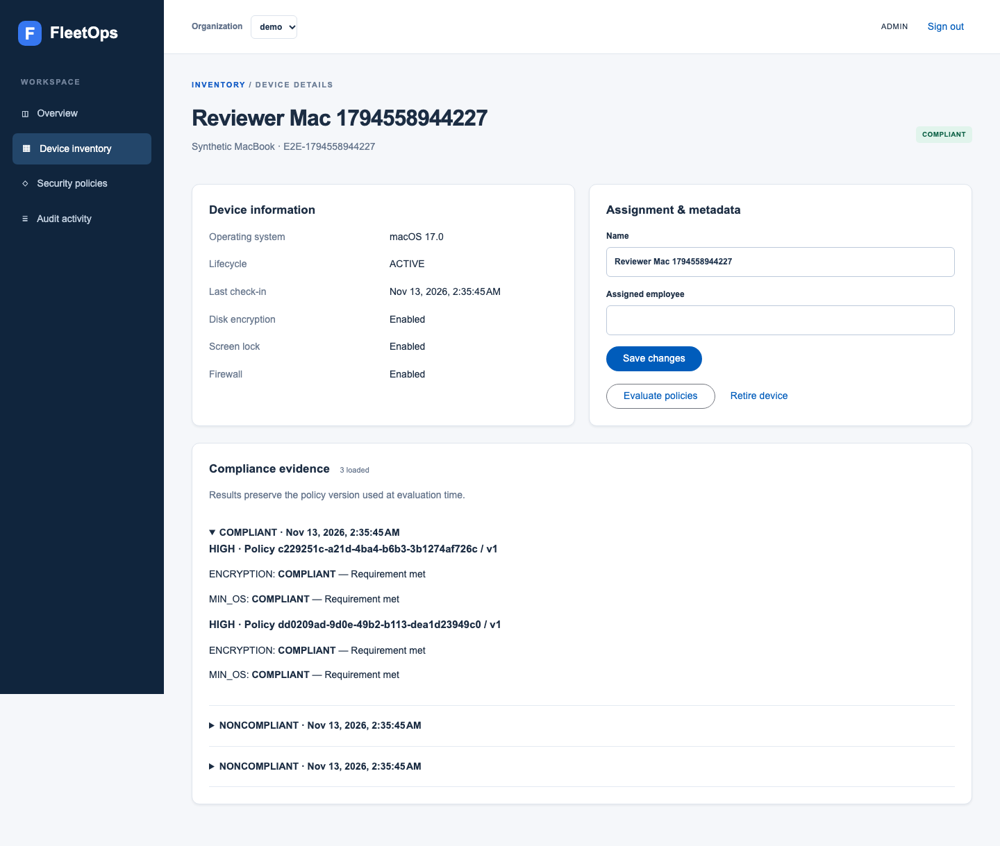
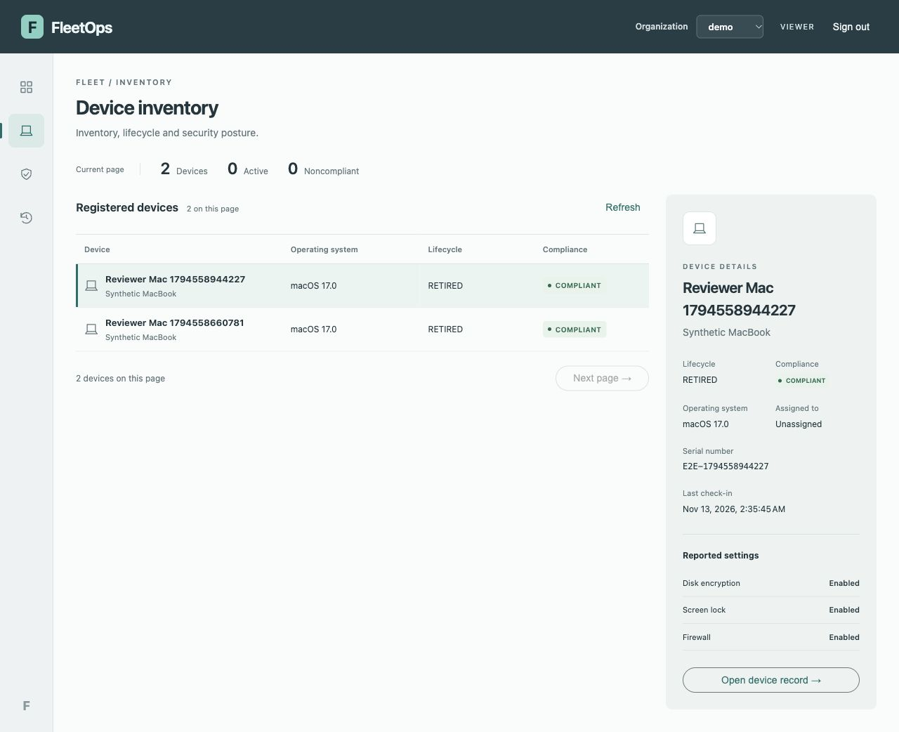
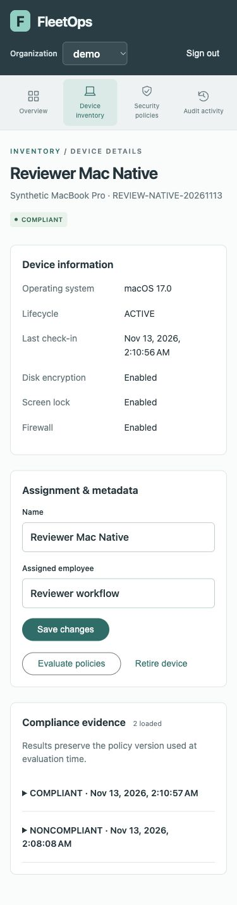

# User stories: real workflow evidence

The interactive Sites preview illustrates UI states. The images below come from the real authenticated application using synthetic data, not from that preview. November13,2026 Docker acceptance includes actual Spring Boot, Keycloak and DynamoDB Local. Earlier screenshots retain their original styling; Operations images are marked separately.

## Administrator provisions a device

An administrator registers a synthetic Mac; the machine identity cannot register devices. The real browser suite creates the record through the UI, checks the initial lifecycle/compliance and then submits authenticated reports. See [executable acceptance](../frontend/e2e/fleet.spec.ts) and [permission matrix](security/PERMISSIONS.md).

Operations inventory from the native authenticated app, captured November13. This shows the resulting fleet and selected record, not a screenshot of the registration request itself.

## Machine report fails the security baseline

A report with encryption disabled and an old OS produces NONCOMPLIANT while lifecycle remains ACTIVE. Policy version and failed rules are retained as evidence.

Docker acceptance capture, November13,083527Z run; earlier interface. No backend mock.

## Corrected report restores compliance

The next report meets the policy. Compliance becomes COMPLIANT; lifecycle remains ACTIVE, and the earlier evaluation remains in history. Accepted-report replays and changed-content conflicts are also tested in backend restart scenarios; a screenshot alone does not prove idempotency.

Same authenticated workflow and device as the failure capture.

## Viewer can inspect, not provision

Real Docker Keycloak viewer session, Operations design. The browser suite separately verifies API denial for viewer writes and cross-tenant access; absent buttons alone are not the security boundary. Retired devices remain RETIRED despite passing compliance.

## Responsive inspection

Real native application capture. For a complete live walkthrough, follow [DEMO.md](DEMO.md). No recorded video or cloud backend is claimed by this screenshot collection.
