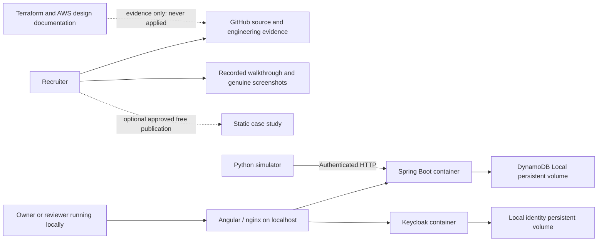

# FleetOps: strict $0 hosting and portfolio plan

Updated 2026-11-13. **This is the current strategy and supersedes the paid and scheduled-AWS recommendations in HOSTING_PROPOSAL.md.** No hosting, infrastructure, domain, database, deployment or extra usage spending is permitted. Existing ChatGPT Pro, personal computer and internet are treated as already-owned resources; this is $0 incremental service spending, not a claim that electricity or the existing subscription is free.

## Decision

Use **GitHub source/evidence + a recorded walkthrough + the reproducible local Docker application**. Do not publish the Angular application by itself. Keep Spring Boot, Keycloak and DynamoDB Local in the existing Docker architecture, with synthetic records and loopback ports. Preserve A1–A3, report integrity, lifecycle/compliance separation, tenant authorization and the standard-library simulator.

No suitable free public full-stack host was confirmed among the services researched that simultaneously meets all of these conditions: no payment method, no automatic paid upgrade, no unexpected charges, persistent identity/application data, sufficient resources, and preservation of this architecture. This is a scoped research conclusion, not a claim that no such service could ever exist.

Optional later: publish a clearly presented **project case study** on an included/free static host, with genuine screenshots, recording, architecture and source links. It must not present disconnected login, fleet operations or fake live compliance data. Use “Watch walkthrough,” “View source” and “Run locally,” not “Launch live app.” Publication and access changes require explicit approval.

## Sites and ChatGPT Pro

OpenAI's current documentation explicitly says Sites hosting is included with ChatGPT Plus and Pro. Building/editing consumes existing Codex usage; shared limits still apply. The user's stated Pro subscription therefore supports **$0 additional hosting under the currently documented entitlement**. This is documentation verification, not inspection of the user's billing account or confirmation of public-publishing eligibility. Do not buy credits, upgrade plans or accept an unexpected charge prompt. If included limits are reached, stop. [Official Sites documentation](https://help.openai.com/en/articles/20001339-creating-and-using-chatgpt-sites).

The installed Sites plugin supports static output and Worker code, not the existing JVM/container stack. Angular assets are technically packageable, but this application's `/api/` proxy and localhost Keycloak issuer need reachable services. A recruiter's localhost is their own computer. Sites hosting does not turn the owner's Mac into a hosted backend. No tunnel, auth bypass, replacement identity provider or simulated backend is proposed.

**Verdict:** suitable candidate for a $0 showcase under existing Pro; unsuitable for publishing this working application alone. Retain Angular unchanged locally. For a future showcase verify public access and HTTPS on the provided host URL, without buying a domain. Do not claim external visibility before testing it with the selected audience.

## Free static alternatives

All options below are for a case study/recording index, not the disconnected FleetOps application. Use provider subdomains, static HTML/assets only, no functions, managed databases, paid analytics, image services or other add-ons. No signup or publication was performed.

| Option | $0 eligibility and limits | Fit and approval gate |
|---|---|---|
| Sites with existing Pro | Hosting currently included; building/editing draws on plan usage; public access depends on account/workspace settings | Convenient first option. Confirm included entitlement/public audience; stop on any paid prompt. |
| GitHub Pages on GitHub Free | Available from a public repository; provider `github.io` address; static files, no backend | Best fallback for a technical case study. Current FleetOps repository is private: publicizing it or creating a separate public showcase requires approval. GitHub Pro is distinct from ChatGPT Pro; do not assume one grants the other. |
| Cloudflare Pages Free | Static asset requests are free/unlimited; Free plan has build/file limits including 25 MiB per asset | Good static fallback on `pages.dev`. Stay on Free with no paid Workers/R2 or billing activation. Large video will not fit one asset; link to separately approved free video sharing instead. If onboarding requires payment details, reject it. |
| Vercel Hobby | Free personal/noncommercial tier with capped usage, not paid overage; provider domain | Personal portfolio candidate. Confirm account remains Hobby; no Pro trial, team upgrade or add-ons. Less compelling than Pages for this simple showcase. |

Sources: [GitHub Pages eligibility](https://docs.github.com/en/pages/getting-started-with-github-pages/what-is-github-pages), [Cloudflare static pricing](https://developers.cloudflare.com/pages/functions/pricing/), [Cloudflare limits](https://developers.cloudflare.com/pages/platform/limits/), [Cloudflare free onboarding](https://www.cloudflare.com/products/), [Vercel Hobby](https://vercel.com/docs/plans/hobby), [Vercel capped free usage](https://vercel.com/pricing).

These are free static options, not guarantees that every feature or account configuration is free. At a limit, accept blocked builds/service rather than a payment request. No provider account settings have been inspected or changed.

## Free full-stack screening

| Candidate | Result under this project's requirements |
|---|---|
| AWS Free Tier / promotional credits | Excluded. Credits and budgets are not a guaranteed permanent $0 service. No AWS resources, billing activation, public IPs, domains, storage or deployment roles will be provisioned. |
| Oracle Always Free | Excluded at the eligibility gate: signup requires card information. No capacity or deployment experiment is warranted. [Oracle FAQ](https://www.oracle.com/cloud/free/faq/). |
| Render Free | Does not provide durable disk for free services; free PostgreSQL expires after 30 days; services sleep. That cannot preserve the current local Keycloak and DynamoDB Local data safely. Payment verification requirements need account-specific confirmation, but the persistence failure already disqualifies it. [Render Free](https://render.com/docs/free). |
| Railway Free | No-card trial/free path exists, but the recurring $1 credit and resource restrictions do not establish a durable, reliable multi-service Java demo. Do not upgrade to Hobby or spend beyond free credit. Not selected. [Railway free trial](https://docs.railway.com/pricing/free-trial). |
| Fly.io trial | Two total VM hours within a seven-day trial is not permanent hosting; apps stop when the trial is exhausted until a payment method is added. Excluded. [Fly trial](https://fly.io/docs/about/free-trial/). |
| Hugging Face Spaces | Current docs say compute Spaces require a paid plan, despite CPU Basic having no hourly charge; default disk is nonpersistent. ChatGPT Pro is unrelated to Hugging Face paid plans. Excluded. [Spaces overview](https://huggingface.co/docs/hub/en/spaces-overview). |
| Sites / Cloudflare / Vercel static tiers | No free JVM + Keycloak + persistent DynamoDB Local service demonstrated through these static products. Rewriting to Worker/serverless databases would violate the architecture requirement. |

We will not keep services awake with artificial traffic, repeatedly recreate trials, expose development credentials to the internet, or substitute an in-memory identity/database merely to produce a link.

## $0 demonstration architecture

There is no public route from the showcase to the local application. Current local development identity remains local; adding PostgreSQL or production identity settings from the earlier proposal is not part of this strategy.

## Reproducible local demonstration

Use the existing [DEMO.md](DEMO.md) and [SIMULATOR.md](SIMULATOR.md); the existing generator and real Playwright suite are the executable baseline. Do not run a second project on occupied reviewer ports or delete old volumes to make room.

1. Record the source commit and Docker/Compose versions. Ensure local disk space is adequate; a previous Docker interruption was caused by a full disk. Do not prune/delete unrelated images or data automatically.
2. Inspect whether the existing isolated stack owns ports 14200/18080/18180/18000. Reuse it for viewing. For a fresh capture, first obtain approval for stopping the specifically identified old reviewer stack, preserving volumes, then choose a fresh project name. No process changes are performed by this planning task.
3. From the repository root, prepare fixtures with the existing helper, for example `python3 scripts/prepare-reviewer.py --project fleetops-reviewer-recording`. It prints the exact Compose validation/start commands and refuses overwrite. A new project creates separate identity and application volumes; no migration/reset of current data.
4. Run the printed commands only when the local execution is approved. Wait for API `/actuator/health/readiness`, issuer discovery and frontend `/config.json` on reviewer ports. Check actual Docker-backed operation, not just a screenshot or mocked server.
5. Use the acceptance workflow to provision uniquely named synthetic devices, submit restricted-machine reports, show failure/recovery, verify viewer/cross-tenant denials and retire a device without compliance reactivating it. Existing seeded simulator inventory uses seed42; timestamps/report IDs remain intentionally fresh.
6. Run the browser suite using the exact overrides in DEMO.md. The current source contains three tests. Preserve data generated by the suite; repeated runs consume the documented policy cap. Do not claim identical IDs/timestamps across executions.
7. Capture a separate narrated tour using the recording storyboard below. Tests retire their device; explain that final state or use a separately provisioned synthetic walkthrough device rather than silently changing stored history.
8. Save evidence with source commit, timestamp, environment/ports, command and actual result. Keep raw token-bearing traces and simulator/session state ignored. Review every frame for credentials, personal desktop notifications and unrelated tabs.

No new containers were started, tests rerun or video recorded for this planning revision. Existing screenshots and passing results remain genuine historical evidence, not a newly executed capture.

## Recording and screenshot deliverables

Use the existing Mac screen recorder (Screenshot/QuickTime), at 1440×900 or 1920×1080, readable browser zoom, microphone narration and a clean browser window. No paid editor or stock assets. Produce a 3–5 minute MP4 plus a text transcript; watch it end to end before sharing. Never film access-token extraction, authorization headers or developer storage panels. Public local fixture passwords are still best kept out of the narrative so they cannot be mistaken for hosted credentials.

| Time | Picture and action | Technical point |
|---|---|---|
| 0:00–0:25 | Operations inventory and selected device inspector | Angular talks to real Spring Boot, Keycloak and DynamoDB Local via Docker. State that this recording is local in the narration/README, not a banner inside the product. |
| 0:25–1:00 | Administrator registers a synthetic Mac | REGISTERED and UNKNOWN; separate admin provisioning and machine reporting. |
| 1:00–1:45 | Machine report fails encryption/minimum-OS policy; inspect evidence | ACTIVE and NONCOMPLIANT are independent. Show versioned policy rules. |
| 1:45–2:25 | Corrected report, current inspector and retained older evidence | COMPLIANT recovery without rewriting history or lifecycle. |
| 2:25–3:10 | Viewer account, plus readable real denial-test results | Backend denies writes and cross-tenant access; hidden buttons are not the security boundary. |
| 3:10–3:50 | Replay/ordering tests and green GitHub run | A/B/A replay, conflicting IDs and restart persistence; show verified results, not invented live output. |
| 3:50–4:30 | Architecture, Docker setup, test inventory and Terraform folder | Explain tradeoffs, $0 local delivery and planned—not deployed—AWS infrastructure. |

Use a small screenshot set: Operations desktop, noncompliance evidence, recovered evidence, viewer restriction and mobile inspector. Already available: `docs/screenshots/operations-inventory.jpg`, `operations-docker-viewer.jpg`, `operations-mobile.jpg`, `reviewer-docker-failure.png`, `reviewer-docker-recovery.png`. Earlier reviewer PNGs predate the Operations styling; retain their provenance and recapture them in the selected theme during recording rather than relabeling them. Never turn static screenshots into fake interactive fleet screens.

Keep the finished video local until sharing is approved. Optional free publication can use an existing free video account/provider link, subject to its current no-charge terms and upload approval. Do not activate paid object storage or Git LFS merely to store a large video. A local MP4 plus downloadable transcript remains useful for an interview screen share even without public hosting.

## GitHub, CI and AWS portfolio evidence

Keep the meaningful source history, Dockerfiles/Compose, GitHub Actions checks, Terraform and architecture documents. Describe them accurately:

> FleetOps is an Angular and Spring Boot device-compliance application, authenticated with Keycloak and demonstrated locally using Docker and DynamoDB Local. Automated tests cover tenant isolation, role boundaries, report replay and compliance lifecycle behavior. AWS Terraform is a reviewed infrastructure foundation and has not been applied.

Current known evidence: 34 backend tests, 20 frontend tests, 37 pytest cases plus retained4 unittest cases, real Docker browser workflow, and five successful jobs in Operations [run43397508091](https://github.com/naveenseedani21/fleetops/actions/runs/43397508091). These are recorded prior results; this planning task does not claim fresh test execution. Full feature completion, cloud deployment and physical MDM enrollment are not claimed.

The repository is private. Decide later whether to grant a reviewer access or publish a sanitized repository; neither happens automatically. Before changing visibility, review all history for tokens, real data and token-bearing traces. A separate public case-study repository is an alternative if full-source publication is undesirable.

**CI cost gate:** standard GitHub-hosted runners are free for public repositories, but private-repository usage has included limits and may incur charges with billing enabled. Larger runners and storage have separate cost rules. Preserve the workflow, but do not trigger extra remote runs until current billing controls/included capacity are verified as $0-safe. No new push or workflow dispatch is performed for this plan. Local tests and the existing passing run provide evidence meanwhile; do not disable checks to avoid a failure. [GitHub Actions billing](https://docs.github.com/en/billing/concepts/product-billing/github-actions).

Terraform files remain educational/engineering artifacts; no `apply`, remote paid state backend, cloud credentials or deployment workflow activation. Offline formatting and source review cost no infrastructure money; validate can download providers but does not provision resources. Distinguish configuration validation from actual AWS behavior.

## Cost and approval ledger

| Item | Additional allowed spending | Current action |
|---|---:|---|
| Local Docker app, synthetic data, screen recording | $0 | Plan prepared; retain existing stack/data |
| Existing Pro Sites entitlement | $0 | Research only; optional static showcase |
| Free static provider subdomain | $0 | Alternative only; no signup/deploy |
| Domain, cloud compute/database/storage, tunnel | $0 | Not purchased or provisioned |
| Paid CI, usage credits, premium runner, video storage | $0 | Not enabled; no new remote run triggered |
| Architecture/application changes | Not authorized by this plan | None |

Next deliverable is the genuine recorded walkthrough and refreshed Operations failure/recovery screenshots using the approved local execution scope. Public posting, repository visibility, account access and any infrastructure changes still require explicit approval. If a service cannot demonstrate no extra cost, omit it and use the repository plus recording. No paid fallback is authorized.
