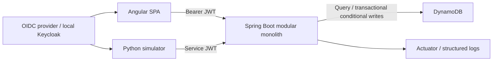

# Architecture

Controllers validate DTOs; services authorize tenant access and coordinate workflows; repositories own AWS SDK requests; a pure engine evaluates policy rules. JWT signature, issuer, audience and expiry are validated. A signed `organizations` map assigns organization roles; platform administrators do not inherit tenant permissions. Production membership revocation is bounded by token expiry; use short-lived access tokens.

Synchronous ingestion keeps a solo-developer system operable. Device state, evaluations and audit events commit atomically. Optimistic revision checks reject concurrent overwrites. Policy versions are immutable. A policy edit does not silently rewrite historical evidence. Re-evaluation is explicit in the initial slice; automatic fleet-wide fan-out remains pending.

Local: Angular reverse proxy → backend; Keycloak development realm; DynamoDB Local. Production target: static Angular on S3/CloudFront, ECS Fargate backend, DynamoDB on-demand, CloudWatch. This target is not a deployment claim.

Tradeoffs: no streaming platform, no arbitrary full-table searches, no unbounded list APIs. Tenant partitions are suitable for modest demo fleets; high-volume tenants would need sharding and materialized reporting. Identity-provider managed memberships simplify the first slice but require administrative tooling for a complete product.
